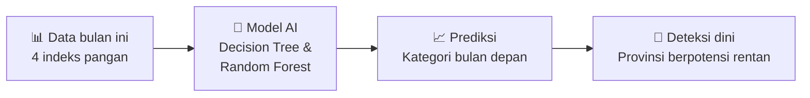
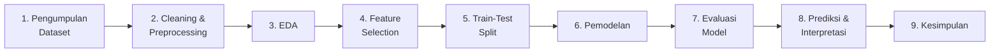

<div align="center">

# 🌾 Prediksi Kategori Ketahanan Pangan Provinsi di Indonesia

### Project Kecerdasan Buatan: SDGs 2 Tanpa Kelaparan

Prediksi tingkat ketahanan pangan provinsi di Indonesia pada **bulan berikutnya** menggunakan *Decision Tree* dan *Random Forest* sebagai sistem peringatan dini.

---
**link Materi**https://drive.google.com/drive/folders/14Im6G67JkbRx-EliCig3tE8ycLOwmuBy

**LInk GoogleColab** https://colab.research.google.com/drive/10J60WVZoodEHC2AoW1NCVfxtadtHVQkL#scrollTo=75da9147

---


</div>

---

## 📑 Daftar Isi

1. [Tim Pengembang](#1--tim-pengembang)
2. [Ringkasan Proyek](#2--ringkasan-proyek)
3. [Latar Belakang](#3--latar-belakang)
4. [Rumusan Masalah dan Tujuan](#4--rumusan-masalah-dan-tujuan)
5. [Solusi yang Diusulkan](#5--solusi-yang-diusulkan)
6. [Dataset](#6--dataset)
7. [Input dan Output](#7--input-dan-output)
8. [Metodologi: 9 Tahapan Pembuatan AI](#8--metodologi-9-tahapan-pembuatan-ai)
9. [Hasil dan Pembahasan](#9--hasil-dan-pembahasan)
10. [Prediksi September 2026](#10--prediksi-september-2026)
11. [Kesimpulan dan Rekomendasi](#11--kesimpulan-dan-rekomendasi)
12. [Keterbatasan dan Pengembangan Lanjutan](#12--keterbatasan-dan-pengembangan-lanjutan)
---


## 1. 👥 Tim Pengembang

**Kelompok 2**

| No | Nama | NIM |
|:---:|---|---|
| 1 | Wa Ode Nur Aisya | F1G125019 |
| 2 | Cinta Aprilianti Hartono Haris | F1G125028 |
| 3 | Fatihah Maulana | F1G125031 |

**Dosen Pengampu:** Ilham Julian Efendi, ST., MT


## 2. 📌 Ringkasan Proyek

Proyek ini dikembangkan untuk memenuhi tugas mata kuliah **Kecerdasan Buatan (*Artificial Intelligence*)**. Fokusnya adalah membangun model *Machine Learning* yang memprediksi **kategori Indeks Komposit ketahanan pangan** setiap provinsi di Indonesia pada bulan berikutnya, berdasarkan data historis indikator ketahanan pangan.

Proyek ini mendukung **SDGs tujuan ke-2: Tanpa Kelaparan (*Zero Hunger*)**.

### Hasil Utama

| Aspek | Hasil |
|---|---|
| Dataset | 1.808 baris, 38 provinsi, periode Juli 2022 s.d. Agustus 2026 |
| Data latih / uji | 1.314 baris / 380 baris (pembagian berdasarkan waktu) |
| Model terbaik (F1 Macro) | **Decision Tree**: F1 Macro 0,577, Accuracy 0,697 |
| Model deteksi rentan terbaik | **Random Forest Balanced**: Recall Kelas 1 = 0,600 |
| Pilar paling berpengaruh | **Pemanfaatan** (4 dari 5 fitur teratas) |
| Provinsi prioritas (September 2026) | Papua Barat Daya, Papua Barat, Papua Selatan, Sulawesi Barat |

---

## 3. 🌱 Latar Belakang

1. **Pangan adalah kebutuhan dasar** yang perlu dipantau secara berkala.
2. **Data tersedia setiap bulan**, sehingga pola perubahan antarbulan dapat dibaca dan dipelajari.
3. **AI dapat berperan sebagai peringatan dini** dengan memprediksi kategori ketahanan pangan bulan berikutnya, sehingga pemantauan dan intervensi dapat direncanakan lebih awal.

---

## 4. ❓ Rumusan Masalah dan Tujuan

### Rumusan Masalah

1. Bagaimana membangun model prediksi kategori ketahanan pangan bulan berikutnya menggunakan *Decision Tree* dan *Random Forest*?
2. Bagaimana kinerja kedua model berdasarkan akurasi, *precision*, *recall*, dan *F1-score*?
3. Seberapa layak model digunakan sebagai peringatan dini untuk mendukung pencapaian SDGs 2?

### Tujuan

1. Membangun model klasifikasi *Decision Tree* dan *Random Forest*.
2. Membandingkan kinerja model menggunakan akurasi, *precision*, *recall*, dan *F1-score*.
3. Mengkaji potensi sistem pemantauan bulanan untuk mendukung SDGs 2.

---

## 5. 💡 Solusi yang Diusulkan

Sistem deteksi dini yang memanfaatkan data bulan berjalan untuk memprediksi kategori bulan berikutnya.



**Manfaat:** pemantauan dapat direncanakan lebih awal pada provinsi yang diprediksi rentan.

---

## 6. 🗂️ Dataset

| Atribut | Keterangan |
|---|---|
| **Sumber** | [Indeks Keamanan Pangan Segar, Badan Pangan Nasional](https://data.badanpangan.go.id/datasetpublications/255/indeks-keamanan-pangan-segar) |
| **Ukuran** | 1.808 baris × 8 kolom |
| **Cakupan wilayah** | 38 provinsi |
| **Periode** | Juli 2022 s.d. Agustus 2026 (50 periode bulanan) |
| **Missing value** | 0 pada seluruh kolom |
| **Duplikat Provinsi-Periode** | 0 |

### Deskripsi Kolom

| Kolom | Tipe | Keterangan |
|---|---|---|
| `Tahun` | Numerik | Tahun rilis data |
| `Bulan Rilis` | Teks | Nama bulan rilis (dikonversi menjadi `Periode`) |
| `Provinsi` | Kategorikal | Nama provinsi |
| `Kode_Provinsi` | Numerik | Kode provinsi |
| `Indeks_Ketersediaan` | Ordinal (1-3) | Pilar ketersediaan pangan |
| `Indeks_Keterjangkauan` | Ordinal (1-3) | Pilar keterjangkauan pangan |
| `Indeks_Pemanfaatan` | Ordinal (1-3) | Pilar pemanfaatan pangan |
| `Indeks_Komposit` | Ordinal (1-3) | Indeks gabungan ketahanan pangan (**basis target**) |

### Contoh Data

| Tahun | Bulan Rilis | Provinsi | Kode | Ketersediaan | Keterjangkauan | Pemanfaatan | Komposit |
|---|---|---|---|---|---|---|---|
| 2022 | Juli | Aceh | 11 | 2 | 3 | 3 | 3 |
| 2022 | Juli | Sumatera Utara | 12 | 2 | 3 | 3 | 3 |
| 2022 | Juli | Sumatera Barat | 13 | 2 | 3 | 3 | 3 |
| 2022 | Juli | Riau | 14 | 2 | 3 | 3 | 3 |
| 2022 | Juli | Jambi | 15 | 2 | 3 | 3 | 3 |

> ⚠️ Dataset **tidak** memuat jumlah penduduk, konsumsi, atau kebutuhan pangan secara langsung. Hasil harus ditafsirkan sebagai prediksi **kategori indeks komposit** ketahanan pangan.

---

## 7. 🔄 Input dan Output

### Input (Fitur)

| Kelompok Fitur | Contoh | Jumlah |
|---|---|---|
| Indeks bulan berjalan | `Indeks_Ketersediaan`, `Indeks_Keterjangkauan`, `Indeks_Pemanfaatan`, `Indeks_Komposit` | 4 |
| Perubahan dari bulan sebelumnya | `Perubahan_Pemanfaatan`, `Perubahan_Komposit`, ... | 4 |
| *Lag* 1 bulan | `Lag1_Pemanfaatan`, `Lag1_Komposit`, ... | 4 |
| *Lag* 2 bulan | `Lag2_Pemanfaatan`, `Lag2_Komposit`, ... | 4 |
| Rata-rata bergerak 3 bulan | `Rata3_Pemanfaatan`, `Rata3_Komposit`, ... | 4 |
| Provinsi (*One Hot Encoding*) | `Provinsi_Sulawesi Barat`, ... | 38 |
| **Total setelah encoding** | | **58** |

### Output (Target)

Kategori `Indeks_Komposit` pada **bulan berikutnya**:

| Kelas | Kategori |
|:---:|---|
| **1** | 🔴 Rentan |
| **2** | 🟡 Sedang |
| **3** | 🟢 Aman |

---

## 8. 🧭 Metodologi: 9 Tahapan Pembuatan AI



### Tahap 1: Pengumpulan Dataset

Dataset dimuat dari berkas CSV (1.808 baris × 8 kolom) yang bersumber dari Badan Pangan Nasional.

### Tahap 2: Cleaning & Preprocessing

| Langkah | Keterangan |
|---|---|
| Pemeriksaan awal | Cek tipe data, *missing value*, duplikat, dan statistik deskriptif |
| Pembentukan `Periode` | Nama bulan Indonesia dipetakan ke angka, lalu digabung dengan `Tahun` menjadi tanggal. Bulan gagal dipetakan: 0 |
| Pengurutan | Data diurutkan per `Provinsi` dan `Periode` |
| Pembuatan target | `Target_Bulan_Berikutnya` = `Indeks_Komposit` bulan berikutnya per provinsi (`shift(-1)`) |
| Validasi urutan | Target hanya dipakai jika benar-benar bulan kalender berikutnya, jika ada bulan yang lompat target dikosongkan |
| *Feature engineering* | Perubahan bulanan, *lag* 1 dan 2 bulan, rata-rata bergerak 3 bulan |

**Rentang data setelah cleaning:** 2022-07 sampai 2026-08.

### Tahap 3: Exploratory Data Analysis (EDA)

**Statistik indeks**

| Indeks | Mean | Std | Min | Max |
|---|:---:|:---:|:---:|:---:|
| Ketersediaan | 2,26 | 0,56 | 1 | 3 |
| Keterjangkauan | 2,69 | 0,51 | 1 | 3 |
| Pemanfaatan | 2,48 | **0,72** | 1 | 3 |
| Komposit | 2,48 | 0,57 | 1 | 3 |

**Distribusi target (data siap model)**

| Kelas | Jumlah | Persentase |
|:---:|:---:|:---:|
| 1 (Rentan) | 63 | 3,7% |
| 2 (Sedang) | 787 | 46,5% |
| 3 (Aman) | 844 | 49,8% |

**Temuan penting**

- Pilar **Pemanfaatan** paling bervariasi (std 0,72).
- Kelas **Rentan sangat sedikit** (3,7%), sehingga data **tidak seimbang**.
- Korelasi tertinggi dengan target: **Pemanfaatan (0,576)**.

**10 fitur dengan korelasi tertinggi terhadap target (berurutan):**
`Rata3_Pemanfaatan`, `Indeks_Pemanfaatan`, `Lag1_Pemanfaatan`, `Lag2_Pemanfaatan`, `Rata3_Komposit`, `Indeks_Komposit`, `Lag1_Komposit`, `Lag2_Komposit`, `Indeks_Keterjangkauan`, `Rata3_Keterjangkauan`.

### Tahap 4: Feature Selection

| Langkah | Jumlah Fitur |
|---|:---:|
| Fitur setelah *One Hot Encoding* | 58 |
| Fitur dipilih (`SelectKBest` + *Mutual Information*) | **40** |
| Fitur tidak dipilih | 18 |

Proses *fit* seleksi fitur **hanya pada data training** agar tidak terjadi *data leakage*.

**10 fitur teratas berdasarkan *Mutual Information***

| Peringkat | Fitur | Mutual Information |
|:---:|---|:---:|
| 1 | `Lag1_Pemanfaatan` | 0,1918 |
| 2 | `Rata3_Pemanfaatan` | 0,1907 |
| 3 | `Rata3_Komposit` | 0,1892 |
| 4 | `Lag2_Pemanfaatan` | 0,1772 |
| 5 | `Indeks_Pemanfaatan` | 0,1765 |
| 6 | `Indeks_Komposit` | 0,1306 |
| 7 | `Lag2_Komposit` | 0,1015 |
| 8 | `Lag1_Komposit` | 0,0876 |
| 9 | `Rata3_Ketersediaan` | 0,0367 |
| 10 | `Provinsi_Sulawesi Barat` | 0,0361 |

### Tahap 5: Train-Test Split (Berdasarkan Waktu)

Data dibagi **berdasarkan waktu, bukan acak**, agar model diuji pada periode yang belum pernah dilihat dan tidak "mengintip" masa depan.

| Data | Proporsi | Jumlah | Periode |
|---|:---:|:---:|---|
| Training | 77,57% | 1.314 baris | 2022-09 s.d. 2025-09 |
| Testing | 22,43% | 380 baris | 2025-10 s.d. 2026-07 |

### Tahap 6: Pemodelan

Seluruh model memakai alur **Preprocessing → SelectKBest (40 fitur) → Model** dengan `random_state=42`.

| Model | Deskripsi | Hyperparameter |
|---|---|---|
| **Baseline** | Patokan pembanding: memakai `Indeks_Komposit` bulan ini sebagai prediksi bulan depan | n/a |
| **Decision Tree** | Aturan percabangan seperti pohon | `max_depth=5`, `min_samples_leaf=5` |
| **Random Forest** | Gabungan banyak pohon, prediksi lebih stabil | `n_estimators=300`, `max_depth=8`, `min_samples_leaf=3` |
| **RF Balanced** | Random Forest yang menyeimbangkan bobot kelas | Sama seperti Random Forest + `class_weight="balanced"` |

### Tahap 7: Evaluasi Model

Metrik: Accuracy, Precision (macro), Recall (macro), F1 (macro), Precision & Recall Kelas 1 (Rentan), ROC-AUC (OvR, macro), dan *confusion matrix*.

### Tahap 8: Prediksi & Interpretasi

*Feature importance* diambil dari model operasional (model dengan Recall Kelas 1 tertinggi), kemudian dipakai memprediksi bulan berikutnya dari data periode terakhir.

### Tahap 9: Kesimpulan

Pemilihan model terbaik, model prioritas deteksi rentan, dan daftar provinsi prioritas pemantauan.

---

## 9. 📊 Hasil dan Pembahasan

### 8.1 Perbandingan Metrik (380 data uji)

| Model | Accuracy | Prec. Macro | Recall Macro | F1 Macro | Prec. Kelas 1 | Recall Kelas 1 | ROC-AUC |
|---|:---:|:---:|:---:|:---:|:---:|:---:|:---:|
| Baseline | 0,668 | 0,575 | 0,566 | 0,569 | 0,357 | 0,333 | - |
| **Decision Tree** | **0,697** | **0,717** | 0,545 | **0,577** | **0,750** | 0,200 | 0,779 |
| Random Forest | **0,697** | 0,690 | 0,525 | 0,547 | 0,667 | 0,133 | **0,825** |
| **RF Balanced** | 0,642 | 0,536 | **0,629** | 0,549 | 0,205 | **0,600** | 0,793 |

| 🏆 Kategori | Model | Nilai |
|---|---|---|
| F1 Macro terbaik | Decision Tree | 0,577 |
| Deteksi rentan terbaik (Recall Kelas 1) | RF Balanced | 0,600 |
| ROC-AUC tertinggi | Random Forest | 0,825 |

### 9.2 Confusion Matrix

Baris = kelas aktual, kolom = kelas prediksi (1 = Rentan, 2 = Sedang, 3 = Aman).

**Baseline**

| Aktual \ Prediksi | 1 | 2 | 3 |
|:---:|:---:|:---:|:---:|
| **1** | 5 | 10 | 0 |
| **2** | 9 | 128 | 47 |
| **3** | 0 | 60 | 121 |

**Decision Tree**

| Aktual \ Prediksi | 1 | 2 | 3 |
|:---:|:---:|:---:|:---:|
| **1** | 3 | 12 | 0 |
| **2** | 1 | 139 | 44 |
| **3** | 0 | 58 | 123 |

**Random Forest**

| Aktual \ Prediksi | 1 | 2 | 3 |
|:---:|:---:|:---:|:---:|
| **1** | 2 | 13 | 0 |
| **2** | 1 | 138 | 45 |
| **3** | 0 | 56 | 125 |

**RF Balanced**

| Aktual \ Prediksi | 1 | 2 | 3 |
|:---:|:---:|:---:|:---:|
| **1** | 9 | 6 | 0 |
| **2** | 32 | 112 | 40 |
| **3** | 3 | 55 | 123 |

### 9.3 Interpretasi Hasil

- **Decision Tree** unggul pada F1 Macro dan precision, tetapi hanya menangkap **3 dari 15** kasus rentan.
- **Random Forest** memiliki ROC-AUC tertinggi (0,825), namun paling lemah dalam mendeteksi kelas rentan (**2 dari 15**).
- **RF Balanced** menangkap **9 dari 15** kasus rentan (Recall 0,600), dengan konsekuensi **35 alarm palsu** (32 kelas sedang + 3 kelas aman diprediksi rentan) dan akurasi lebih rendah.
- Untuk **peringatan dini**, kehilangan kasus rentan umumnya lebih merugikan daripada alarm palsu, sehingga **RF Balanced dipilih sebagai model operasional**.

### 9.4 Feature Importance (RF Balanced)

| Peringkat | Fitur | Importance |
|:---:|---|:---:|
| 1 | `Rata3_Pemanfaatan` | 0,136 |
| 2 | `Indeks_Pemanfaatan` | 0,128 |
| 3 | `Lag1_Pemanfaatan` | n/a |
| 4 | `Rata3_Komposit` | n/a |
| 5 | `Lag2_Pemanfaatan` | n/a |
| 6 | `Indeks_Komposit` | n/a |
| 7 | `Rata3_Keterjangkauan` | n/a |
| 8 | `Lag1_Komposit` | n/a |
| 9 | `Lag2_Komposit` | n/a |
| 10 | `Indeks_Keterjangkauan` | n/a |

> Pilar **Pemanfaatan** mendominasi: 4 dari 5 fitur teratas. Hal ini selaras dengan hasil korelasi dan *Mutual Information*.

---

## 10. 🔮 Prediksi September 2026

Menggunakan **RF Balanced** dengan data terakhir **Agustus 2026**.

| Prediksi Skor | Jumlah Provinsi |
|:---:|:---:|
| 3 (Aman) | 23 |
| 2 (Sedang) | 11 |
| 1 (Rentan) | **4** |

### 11 Provinsi dengan Peluang Rentan Tertinggi

| # | Provinsi | Indeks Kini | Prediksi | Peluang Rentan (%) |
|:---:|---|:---:|:---:|:---:|
| 1 | **Papua Barat Daya** | 1 | 1 | **69,45** |
| 2 | **Papua Barat** | 2 | 1 | **69,28** |
| 3 | **Papua Selatan** | 2 | 1 | **56,06** |
| 4 | **Sulawesi Barat** | 1 | 1 | **54,57** |
| 5 | Nusa Tenggara Timur | 2 | 2 | 35,37 |
| 6 | Papua | 2 | 2 | 35,02 |
| 7 | Nusa Tenggara Barat | 2 | 2 | 34,04 |
| 8 | Kalimantan Selatan | 2 | 2 | 30,79 |
| 9 | Kalimantan Barat | 2 | 2 | 20,58 |
| 10 | Kalimantan Timur | 2 | 2 | 10,39 |

---

## 10. ✅ Kesimpulan dan Rekomendasi

### Kesimpulan

1. Model **Decision Tree** terbaik secara keseluruhan (F1 Macro 0,577; Accuracy 0,697).
2. Model **Random Forest Balanced** paling baik mendeteksi kondisi rentan (Recall Kelas 1 = 0,600).
3. Pilar **Pemanfaatan** adalah faktor paling berpengaruh dalam memprediksi indeks komposit bulan berikutnya.
4. Pada **September 2026**, **4 provinsi** diprediksi rentan: **Papua Barat Daya, Papua Barat, Papua Selatan, dan Sulawesi Barat**.

### Rekomendasi

1. Gunakan model terbaik berdasarkan F1 Macro untuk melihat performa keseluruhan.
2. Untuk tujuan deteksi kondisi rentan, gunakan model dengan Recall Kelas 1 tertinggi (RF Balanced).
3. Jadikan provinsi yang diprediksi kelas 1 sebagai **prioritas pemantauan lebih lanjut**.
4. Gunakan hasil prediksi AI sebagai **alat bantu pengambilan keputusan, bukan keputusan akhir**.

---

## 11. ⚠️ Keterbatasan dan Pengembangan Lanjutan

### Keterbatasan

- Kelas Rentan sangat sedikit (3,7% data; hanya **15 sampel** pada data uji), sehingga metrik kelas 1 sensitif terhadap perubahan kecil.
- RF Balanced menghasilkan banyak alarm palsu (35) dan akurasi keseluruhan lebih rendah (0,642).
- Data berupa indeks kategorikal (1-3) tanpa variabel eksternal seperti harga, cuaca, atau produksi pangan.
- Target dibatasi pada prediksi **satu bulan ke depan**.

### Pengembangan Lanjutan

- Menambahkan variabel eksternal (harga pangan, curah hujan, produksi, inflasi).
- Mencoba teknik penanganan data tidak seimbang lain (misalnya SMOTE) dan algoritma lain (misalnya Gradient Boosting).
- Melakukan *hyperparameter tuning* dan validasi silang berbasis deret waktu (*time series cross-validation*).
- Membangun dasbor pemantauan bulanan untuk pemangku kepentingan.

---

## 12. 📁 Struktur Repositori

```
Prediksi_kategori_ketahanan_pangan_kelompok_2/
├── Notebook_AI_Google_Colab.ipynb   # Notebook 9 tahap (sesuaikan nama file)
├── dataset_ai_proyek_2.1.csv        # Dataset (sesuaikan nama file)
└── README.md                        # Dokumentasi proyek
```

---

### Library yang Digunakan

| Library | Fungsi |
|---|---|
| `pandas`, `numpy` | Manipulasi dan analisis data |
| `matplotlib`, `seaborn` | Visualisasi |
| `scikit-learn` | Preprocessing, seleksi fitur, model, dan evaluasi |


---

<div align="center">

*Dikembangkan untuk mendukung **SDGs 2: Tanpa Kelaparan** 🌾*

</div>
